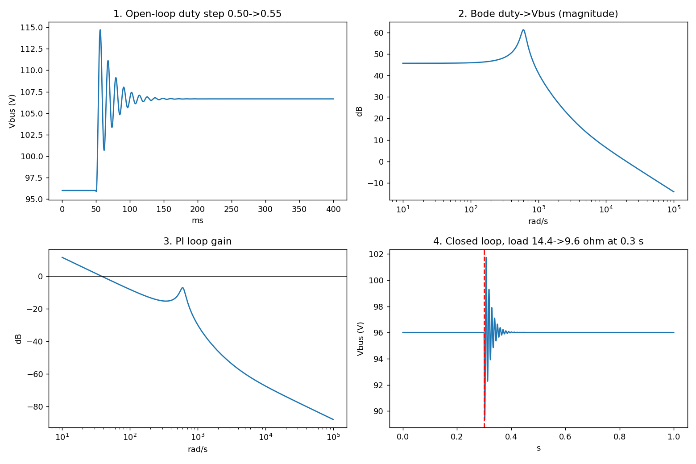
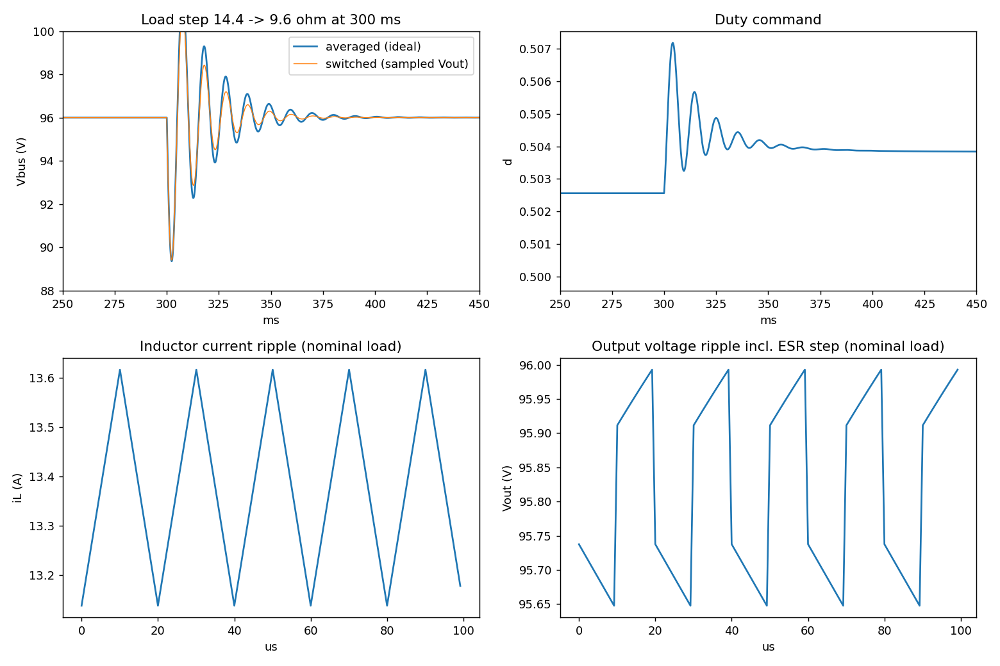
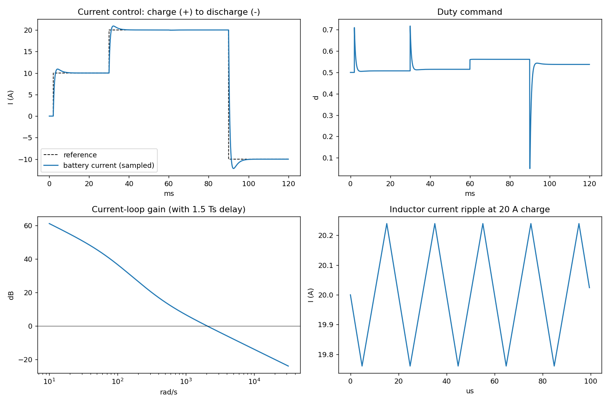

# Bidirectional DC-DC Converter for a BESS Interface: Boost-Mode Voltage Control and Buck-Mode Current Control

*Companion to the SOC estimation project: that one covers the battery side, this one the power-electronics side.*

## 1. Motivation
A battery energy storage system (BESS) needs a DC-DC stage that holds the DC bus steady while the load changes. The discharge direction (boost) is the hard one for control: the plant is lightly damped and non-minimum-phase. The charge direction (buck) is a simple current-control problem. This project covers both. It models the converter, shows why open-loop operation is inadequate, designs a PI voltage loop for discharge that survives a large load step, validates it on a switched model, and then adds a current loop for the charge direction.

## 2. Build
**Averaged CCM model** (states: inductor current *i_L*, bus voltage *v_C*; control: duty *d*):

    L di_L/dt = V_in − (1−d) v_C
    C dv_C/dt = (1−d) i_L − v_C / R

| Parameter | Value |
|---|---|
| V_in | 48 V |
| D₀ | 0.5 (V_bus = 96 V) |
| L, C | 1 mH, 680 µF |
| R | 14.4 Ω (≈ 640 W) |

These values are assumed. 

## 3. Simulate and analyse
**Open loop.** A duty step from 0.50 to 0.55 should take the bus from 96 V to 106.7 V. The nonlinear simulation instead peaks at 114.7 V (about 75% overshoot of the step) and needs about 76 ms to settle. It also dips to 95.9 V first, which is the non-minimum-phase behaviour. The quality factor is Q ≈ 5.9.

**Linearisation.** The duty-to-bus-voltage transfer function has:
- poles at −51 ± j604 rad/s (the resonance),
- a right-half-plane zero at 3600 rad/s, ω_z = R(1−D)²/L,
- a DC gain of +192 V per unit duty, V_in/(1−D)².

The RHP zero caps the usable bandwidth, and the resonance forces the crossover to sit well below it.

## 4. Controller design
A PI controller `d = D₀ + Kp·e + Ki∫e dt` with `e = V_ref − v_C` acts on the duty, with output clamping (0.05 to 0.90) and conditional-integration anti-windup.

**Design iteration.** My first gains (Kp = 1e-3, Ki = 1.0) came from an earlier version of the model. On this plant they are unstable. The loop gain crosses 0 dB near the resonance peak (|G| ≈ 192·Q ≈ 1100) and the gain margin is −6 dB. The fix is to keep the gain at the resonance peak below unity, which gives Ki ≲ 0.5 and an even lower Kp. The final design is **Kp = 2e-4, Ki = 0.2**.

| Metric | Value |
|---|---|
| Crossover | 39 rad/s |
| Phase margin | 91° |
| Gain margin | 8.2 dB |

## 5. Evaluation: load step
The load goes from 14.4 Ω to 9.6 Ω (+50% power) at t = 0.3 s in the full nonlinear simulation.

| Metric | Result |
|---|---|
| Bus voltage dip | 6.6 V (≈ 6.9%) |
| 2% settling time | 24 ms |
| Steady-state error | 0 |

## 6. Validation with a switched model
The averaged model hides switching ripple and parasitics, so I re-ran the same PI controller (unchanged gains) on a switched model: 50 kHz PWM, inductor DCR 20 mΩ, capacitor ESR 20 mΩ (both assumed), exact per-interval integration, and the controller sampled once per switching period.

| Metric | Averaged (ideal) | Switched |
|---|---|---|
| Load-step dip | 6.6 V | 6.6 V |
| 2% settling | 24 ms | 19 ms |
| Duty (nominal → after step) | 0.500 → ~0.504 | 0.5026 → 0.5038 |
| Inductor ripple | n/a | 0.48 A pk-pk (3.6%) |
| Output ripple | n/a | 0.35 V pk-pk at nominal, 0.52 V after the step |

- The converter stays in continuous conduction: the minimum inductor current is 13.1 A at nominal load and 19.9 A after the step.
- The ESR creates a visible voltage step each time the switch changes state, so most of the output ripple comes from the ESR, not the capacitance.
- The cycle-average bus voltage is about 0.2 V (0.2%) below the 96 V reference. The controller regulates a voltage sampled at one point in the switching cycle, and that sample sits slightly above the cycle average.
- The averaged model predicts the transient well. The ringing at the resonance frequency decays a little faster in the switched model, because the DCR and ESR add damping.

## 7. Charge direction: buck-mode current control
**Topology and roles.** The converter is a synchronous half-bridge: the battery sits on the low-voltage side and the DC bus on the high-voltage side. In discharge the converter forms the bus, so it regulates the bus *voltage* (sections 4 to 6). In charge the bus is held by another unit (assumed stiff at 96 V) and the converter regulates the battery *current*. Because the switches are synchronous, the current can reverse without entering discontinuous conduction.

**Model.** The battery is an ideal 48 V source behind an assumed 50 mΩ, plus the 20 mΩ inductor DCR. With the current *I* positive into the battery:

    L dI/dt = d·V_bus − V_bat − R_t·I        (R_t = 70 mΩ)

This is first-order, with none of the resonance or RHP-zero problems of the boost direction.

**Design.** The PI controller targets 2000 rad/s crossover (Kp = L·ωc/V_bus = 0.0208) and has a 1.5-sample delay in the loop. The PI zero sits at ωc/5 (Ki = 8.33), and the duty has bus-voltage feedforward, d_ff = V_bat/V_bus. PWM is centre-aligned and the current is sampled at the start of the period, which equals the true cycle average, so there is no sampling bias.

**Design iteration.** My first version cancelled the plant pole with the PI zero, which gives the cleanest reference step but a poor disturbance response. After an 8% bus sag the current error took about 25 ms to recover, because the cancelled pole (R_t/L, a 14 ms time constant) stays in the closed loop. Moving the zero up to ωc/5 cut that to about 5 ms, and adding the bus feedforward removed the sag error almost entirely.

| Variant | Phase margin | 0→10 A overshoot | Worst current error in 8% bus sag |
|---|---|---|---|
| Pole cancelled, no feedforward | 86.6° | 0 A | 1.97 A (25 ms to recover) |
| Zero at ωc/5, no feedforward | 77.4° | 0.92 A | 1.65 A (4.6 ms to recover) |
| Zero at ωc/5 + feedforward (final) | 77.3° | 0.92 A | 0.05 A |

**Results (switched model, 50 kHz).**
- A 0→10 A reference step rises (10–90%) in 0.8 ms with about 0.9 A overshoot. A 10→20 A step settles to 2% in 4.5 ms.
- The 8% bus sag (96→88 V) at 60 ms moves the duty from 0.515 to 0.561 and leaves the current almost untouched (0.05 A).
- Stepping the reference from +20 A (charge) to −10 A (discharge into the bus) works with the same controller and no mode switch. The overshoot is 2.2 A on a 30 A step.
- Current ripple is 0.48 A pk-pk at 10 A and 20 A, and 0.44 A pk-pk at −10 A.

## 8. Limitations and next steps
- Component values are assumed, not measured from hardware.
- The battery is an ideal source behind a resistance. A real cell's voltage varies with state of charge, so the charge loop would sit inside a CC-CV outer loop.
- In charge mode the bus is assumed stiff. The handover between bus-forming discharge (voltage loop) and bus-following charge (current loop) is not modelled, and neither is the bus dynamics in that handover.
- The discharge design is single-loop voltage mode. Peak-current-mode control, or the current loop from section 7 used as an inner loop, would remove the resonance and the pressure on the gains.
- Next: a cascaded design (voltage loop around the current loop) for discharge, a CC-CV charge profile, and the mode handover logic.
